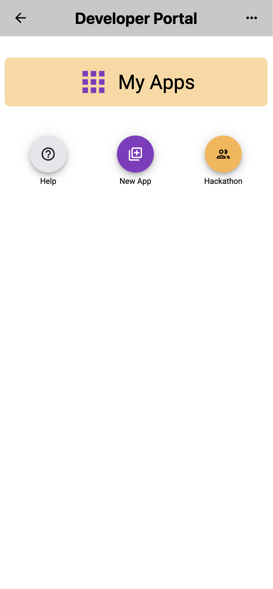
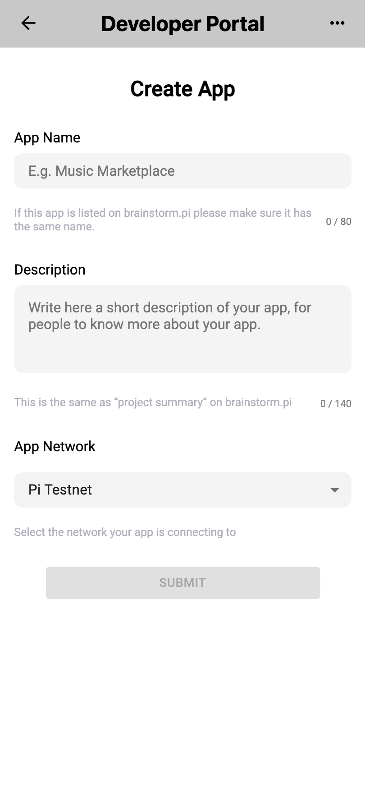
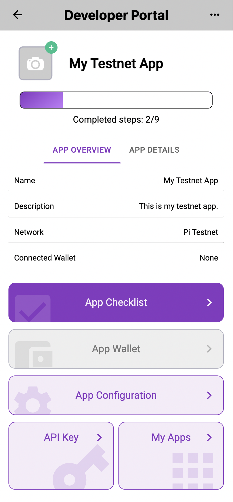
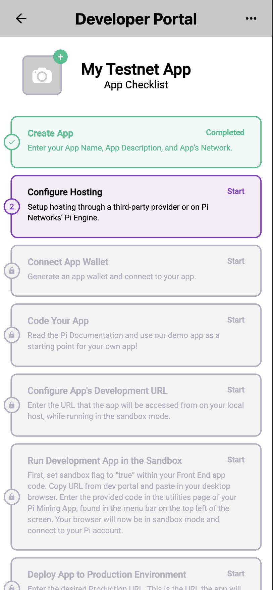
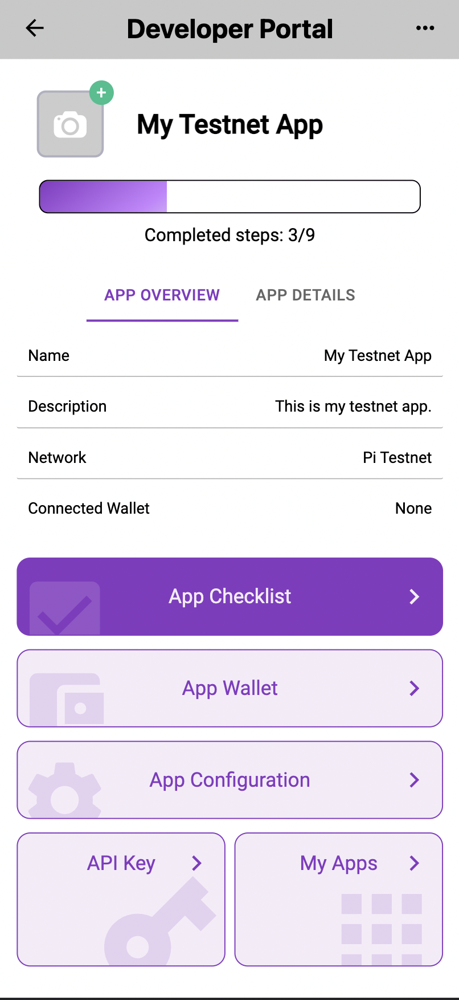
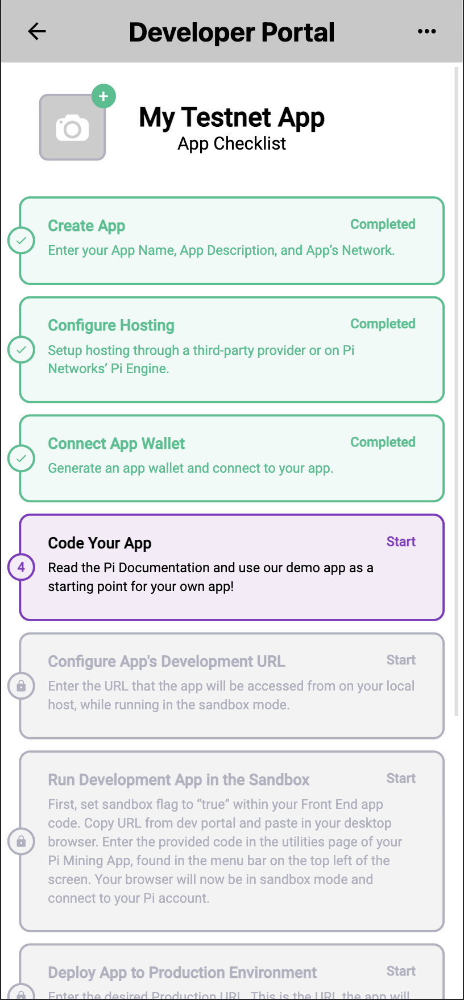
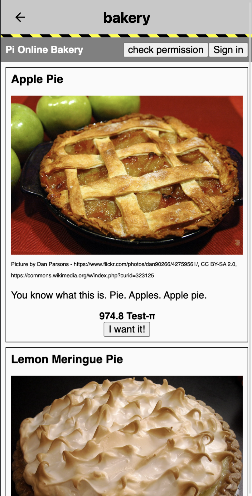

# Portal Developer Pi

Dengan bantuan Pi SDK dan Pi API, Anda dapat membuat aplikasi yang berjalan di dalam Pi Browser dan dapat digunakan oleh Pioneer lain. Portal Developer Pi adalah tempat Anda mendaftarkan dan mengonfigurasi aplikasi Anda agar dapat terhubung ke Blockchain Pi.

## Cara mendaftarkan aplikasi Anda

1. Portal Developer Pi dapat diakses menggunakan Pi Browser. Kunjungi `pi://develop.pi` untuk membuka Portal Developer Pi. Saat pertama kali tiba di halaman utama, Anda belum akan melihat aplikasi apa pun. Untuk mendaftarkan aplikasi Anda, ketuk tombol "New App".

  

 

2. Pada awalnya Anda diminta mengisi 3 kolom wajib. Opsi "App Network" memungkinkan Anda memilih jaringan host yang akan dihubungkan ke aplikasi Anda. Berdasarkan opsi ini, Pi SDK akan secara otomatis menghubungkan aplikasi Anda ke jaringan yang sesuai, baik ke Pi Mainnet maupun Pi Testnet. Perlu diperhatikan bahwa satu aplikasi hanya dapat terhubung ke satu jaringan dalam satu waktu, dan setelah aplikasi didaftarkan, opsi ini tidak dapat diubah. Artinya, Anda disarankan membuat dua aplikasi yang berbeda: satu dengan testnet untuk keperluan pengujian, dan satu dengan mainnet untuk penggunaan produksi Anda.

  

 

3. Setelah aplikasi didaftarkan, Anda dapat melihat detail aplikasi Anda. Setiap aplikasi memiliki "App Checklist" tersendiri, yang membantu Anda memantau langkah-langkah wajib untuk menyiapkan aplikasi Anda hingga berhasil. Untuk melihat daftar periksa tersebut, ketuk tombol "App Checklist".

  

 

4. Langkah-langkah pada daftar periksa akan terbuka satu per satu secara berurutan seiring Anda menyelesaikan setiap langkah. Langkah pertama adalah mengonfigurasi opsi hosting.

  

 

5. Setelah opsi hosting dikonfigurasi, Anda akan melihat tombol "App Wallet" kini aktif, dan langkah daftar periksa berikutnya adalah menghubungkan dompet ke aplikasi. Ikuti petunjuk untuk membuat dompet aplikasi dan menghubungkannya ke aplikasi Anda.

  

 

6. Ketika dompet aplikasi telah terhubung ke aplikasi Anda, daftar periksa akan menampilkan dokumentasi yang dapat Anda pelajari untuk memulai. Dari sini, Anda dapat melihat dan mengikuti langkah-langkah yang tersisa untuk mengonfigurasi aplikasi secara penuh.

  

 

## Aplikasi Testnet di Pi Browser

Jika Anda mendaftarkan aplikasi untuk terhubung ke Pi Testnet dan Anda mengunjungi aplikasi tersebut di Pi Browser, akan tampil garis hitam dan kuning di bagian atas sebagai penanda bahwa aplikasi ini terhubung ke Pi Testnet.

    

## Proyek Lama yang dibuat sebelum 26/07/2022

Proyek yang sudah ada sebelum peluncuran Pi Mainnet SDK akan mengarah ke Pi Testnet

- Hal ini tidak dapat diubah atau diperbarui
- Praktik terbaiknya adalah membuat Proyek Portal Developer baru

### Developer dan Tim dengan Proyek Lama yang dibuat sebelumnya

1. Buat Proyek Portal Developer baru
   - Pilih Mainnet - Ini akan menjadi Versi Mainnet dari Aplikasi tersebut
   - URL
     - Proyek ini harus berisi URL yang diinginkan, yang akan digunakan Pioneer untuk mengakses aplikasi melalui Pi Browser
     - Kepemilikan URL akan ditentukan melalui proses verifikasi
   - Dompet Pembayaran
     - Selama dompet developer/aplikasi belum dibuat, alamat dompet developer yang membuat halaman proyek baru akan digunakan untuk memproses semua transaksi
     - Jika pembuat halaman proyek tidak memiliki Alamat Dompet Pi yang telah dibuat dalam Migrasi Mainnet, semua transaksi akan gagal.
2. Buat Halaman Proyek Developer kedua yang baru
   - Pilih Testnet - Ini akan digunakan untuk keperluan pengujian
   - URL
     - Tidak boleh sama dengan URL Mainnet
     - Harus dimiliki oleh developer juga
   - Atur izin akses yang diinginkan
   - Proyek ini dapat ditautkan ke Proyek Mainnet yang dibuat sebelumnya pada langkah 1
3. Tautkan Proyek Mainnet ke proyek Brainstorm (jika berlaku)
   - Sejak Juli 2022, hanya satu proyek portal developer yang dapat ditautkan ke satu proyek brainstorm

### Pertimbangan Khusus

- Jika sebuah tim aplikasi tidak memiliki anggota dengan Dompet Mainnet
  - Silakan hubungi Pi CT melalui <a href="https://pinetwork.atlassian.net/servicedesk/customer/portal/1/group/3/create/20" target="_blank">Portal Dukungan Pi</a>
  - Untuk pertanyaan "What does your question relate to?"
    - Pilih "Pi Mainnet SDK Wallet"
    - Kirimkan informasi kontak
    - Anggota Pi CT akan menindaklanjuti
